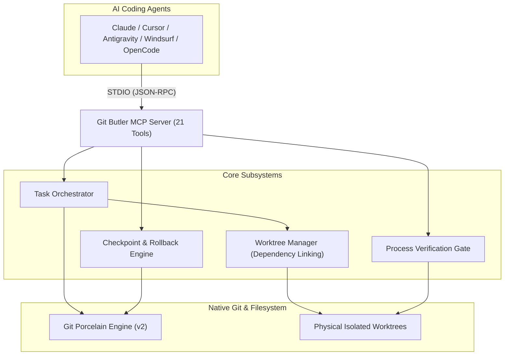

# Git Butler

**Deterministic Git automation, isolated worktrees, and Model Context Protocol (MCP) server for AI coding agents.**

[](https://www.npmjs.com/package/@rohan7/git-butler)
[](LICENSE)
[](https://modelcontextprotocol.io)
[](https://www.typescriptlang.org)
[](https://vitest.dev)

---

## Overview

When autonomous AI coding agents (Claude, Cursor, Antigravity, Windsurf, OpenCode) execute raw terminal Git commands directly, standard workflows break down:

- **Index contention:** Concurrent subagents collide on `.git/index.lock`.
- **Workspace pollution:** Uncommitted user files get overwritten during agent checkouts.
- **Broken dependencies:** Newly allocated worktrees lack `node_modules` and local environment files, causing compilers, linters, and language servers to fail.
- **Unverified merges:** Agents declare tasks complete without running real build or test commands.
- **Accidental main commits:** Incomplete or broken changes get committed directly to protected branches.

**Git Butler** acts as a deterministic control plane between AI coding agents and native Git. It exposes 21 typed MCP tools over STDIO, automatically allocates isolated physical worktrees with zero-copy dependency junctioning, creates instant rollback checkpoints, enforces branch security boundaries, and automates merges upon verification.

---

## Core Capabilities

- **Isolated Worktree Allocation:** Every task receives an isolated physical directory and feature branch. Concurrent subagents work in parallel without lock contention.
- **Automatic Dependency & Environment Linking:** Worktrees automatically link root `node_modules` (via NTFS junction on Windows or symlink on Unix) and copy `.env*` files so dev servers and test suites run immediately without reinstallation.
- **Lifecycle Automation:** `task_start`, `task_batch_start`, `task_continue`, and `task_finish` handle the complete branch-worktree-merge-cleanup pipeline with dirty worktree safeguards.
- **Instant Rollback Checkpoints:** Lightweight snapshot commits allow 1-second recovery if an agent refactor goes wrong.
- **Independent Verification Gates:** Process execution engine runs real compiler, test runner, and linter processes, preventing agents from hallucinating task completion.
- **Security Boundaries:** 4-tier permission policy (`READ_ONLY`, `LOCAL_MUTATION`, `REMOTE_INTERACTION`, `DANGEROUS`) blocks destructive operations and unauthorized pushes to protected branches (`main`, `master`, `production`).
- **Porcelain Ground Truth:** All status, branch, diff, and log outputs are parsed directly from native Git porcelain outputs (`git status --porcelain=v2`, `git for-each-ref`).

---

## Quickstart

### 1. Interactive Setup Wizard (Recommended)

Run the setup wizard to configure Git Butler across your AI tools:

```bash
npx @rohan7/git-butler setup
```

The wizard prompts you to configure:
- **Universal Global Config (`~/.mcp.json`)** — single configuration inherited across all projects and MCP clients.
- **Cursor IDE (`.cursor/mcp.json`)**
- **Anthropic Claude Desktop**
- **Google Antigravity**
- **Windsurf Editor**

You can also run non-interactive setup flags:

```bash
# Configure universal global configuration
npx @rohan7/git-butler setup --global

# Configure specific tools
npx @rohan7/git-butler setup --cursor
npx @rohan7/git-butler setup --claude
npx @rohan7/git-butler setup --antigravity
npx @rohan7/git-butler setup --windsurf
npx @rohan7/git-butler setup --all
```

### 2. Environment Diagnostics

Verify repository health, Git availability, and resolve stale lock files:

```bash
# Check repository diagnostic status
npx @rohan7/git-butler doctor

# Automatically repair stale index.lock files and prune dangling worktrees
npx @rohan7/git-butler doctor --fix
```

### 3. Global CLI Installation (Optional)

```bash
npm install -g @rohan7/git-butler
```

---

## Model Context Protocol (MCP) Configuration

Git Butler exposes 21 typed MCP tools via STDIO.

### Universal Global Config (`~/.mcp.json`)

Works universally across all projects and MCP-compatible editors:

```json
{
  "mcpServers": {
    "git-butler": {
      "command": "npx",
      "args": ["-y", "@rohan7/git-butler", "mcp"]
    }
  }
}
```

### Supported Clients

| Client | Configuration Path | Quick Command |
| :--- | :--- | :--- |
| **Universal Global** | `~/.mcp.json` | `git-butler setup --global` |
| **Cursor** | `.cursor/mcp.json` | `git-butler setup --cursor` |
| **Claude Desktop** | `claude_desktop_config.json` | `git-butler setup --claude` |
| **Google Antigravity** | `~/.gemini/config/mcp_config.json` | `git-butler setup --antigravity` |
| **Windsurf** | `~/.codeium/windsurf/mcp_config.json` | `git-butler setup --windsurf` |

---

## CLI Command Reference

### Setup & Diagnostics
```bash
# Launch interactive configuration wizard
git-butler setup

# Install universal global MCP configuration
git-butler setup --global

# Run diagnostics and auto-repair broken states
git-butler doctor --fix
```

### Task Lifecycle Management
```bash
# Start a new task with an isolated branch and worktree
git-butler task start "Payment Gateway Integration"

# Start multiple tasks in parallel with dedicated worktrees
git-butler task batch "Auth Refactor" "Dashboard UI" "API Rate Limiter"

# List tracked tasks with status, branch, and worktree paths
git-butler task list

# Show detailed task metadata and iterations
git-butler task show <taskId>

# Finish task: merges into target branch, cleans up worktree, and marks COMPLETED
git-butler task finish <taskIdOrName>

# Finish with custom target branch, strategy, or branch deletion:
git-butler task finish <taskIdOrName> --target main --method squash --delete-branch

# Reopen or continue an existing task (restores worktree and increments iteration)
git-butler task continue <taskIdOrName>

# Close task and remove worktree while preserving branch commits
git-butler task close <taskIdOrName>
```

### Checkpoints & Rollback
```bash
# Create an instant snapshot commit before experimental changes
git-butler checkpoint create "Before Database Migration"

# List saved checkpoints with commit SHAs and branches
git-butler checkpoint list

# Roll back workspace to a saved checkpoint
git-butler checkpoint restore <checkpointId> --force
```

### Verification & PR Automation
```bash
# Run verification gates (build, test, lint)
git-butler verify <taskId> --test "pnpm test" --build "pnpm build"

# Create a Pull Request linked to the active task
git-butler pr create --title "feat: payment gateway" --body "Implements webhook handling" --task <taskId>

# Inspect PR status and CI conclusions
git-butler pr status <prNumber>

# Merge PR using squash/rebase strategy
git-butler pr merge <prNumber> --method squash
```

---

## Architecture & Monorepo Packages



| Package | Description |
| :--- | :--- |
| **`@git-butler/core`** | Core schemas, structured error types, and `GitButlerOrchestrator`. |
| **`@git-butler/git`** | Safe non-shell `GitExecutor`, porcelain parsers, and doctor diagnostics. |
| **`@git-butler/worktrees`** | Worktree provisioning, NTFS junction/symlink linking, and pruning. |
| **`@git-butler/tasks`** | Atomic `.ai-git/` persistent store with `.bak` self-healing recovery. |
| **`@git-butler/checkpoints`** | Snapshot commit creation and rollback engine. |
| **`@git-butler/verification`** | Independent subprocess runner and verification gate. |
| **`@git-butler/permissions`** | 4-tier security matrix and protected branch guard. |
| **`@git-butler/github`** | Pull request, CI checks, and merge automation. |
| **`@git-butler/mcp`** | Model Context Protocol STDIO server (21 tools). |
| **`@git-butler/adapters`** | Tool format translators for Anthropic Claude and OpenAI formats. |
| **`@rohan7/git-butler`** | Standalone CLI and unified bundle (`apps/cli`). |

---

## Documentation

- [Architecture & Invariants](docs/ARCHITECTURE.md)
- [MCP Integration Guide](docs/MCP_SETUP.md)
- [Claude Desktop Integration](docs/CLAUDE_GUIDE.md)
- [Cursor IDE Integration](docs/CURSOR_GUIDE.md)

---

## License

Git Butler is distributed under a **Proprietary & Non-Commercial License**.  
Free for individual developer, educational, and internal development workflow use. Commercial resale or redistribution of modified versions without prior authorization is prohibited. See [LICENSE](LICENSE) for details.
